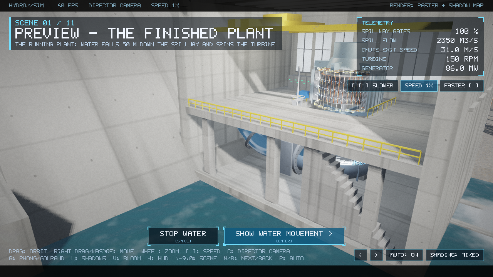
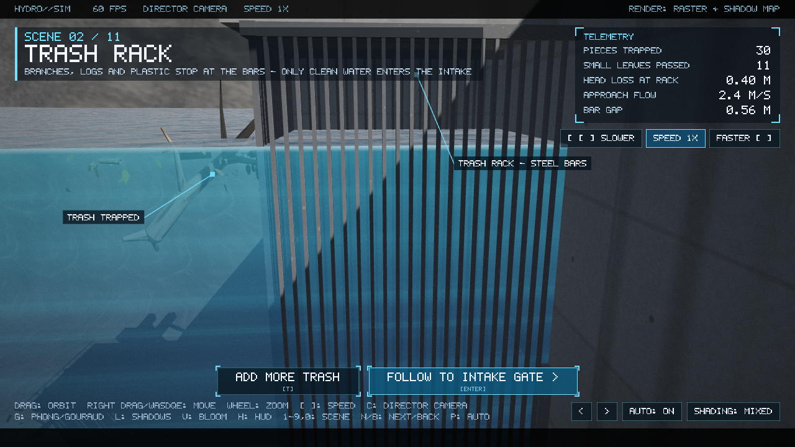
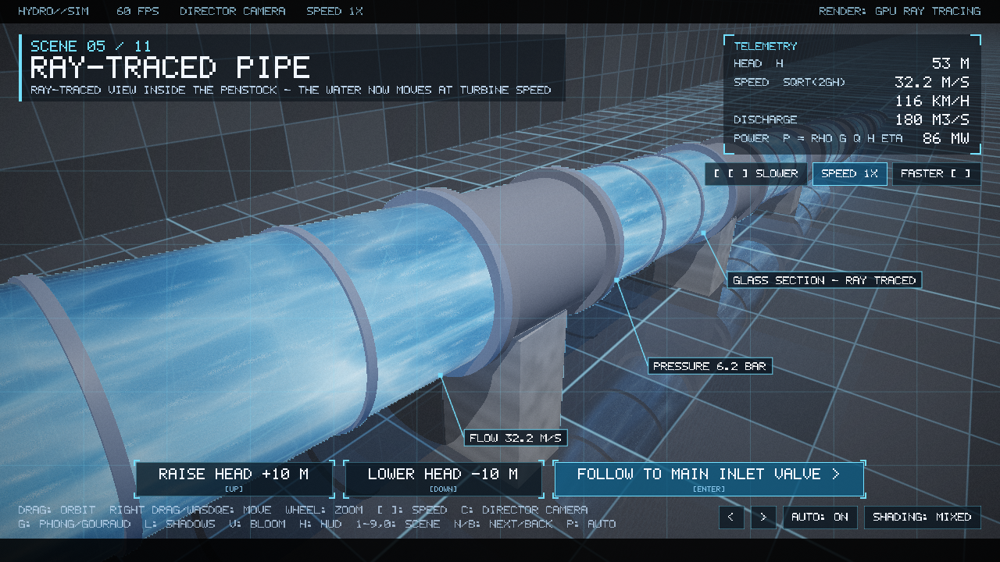
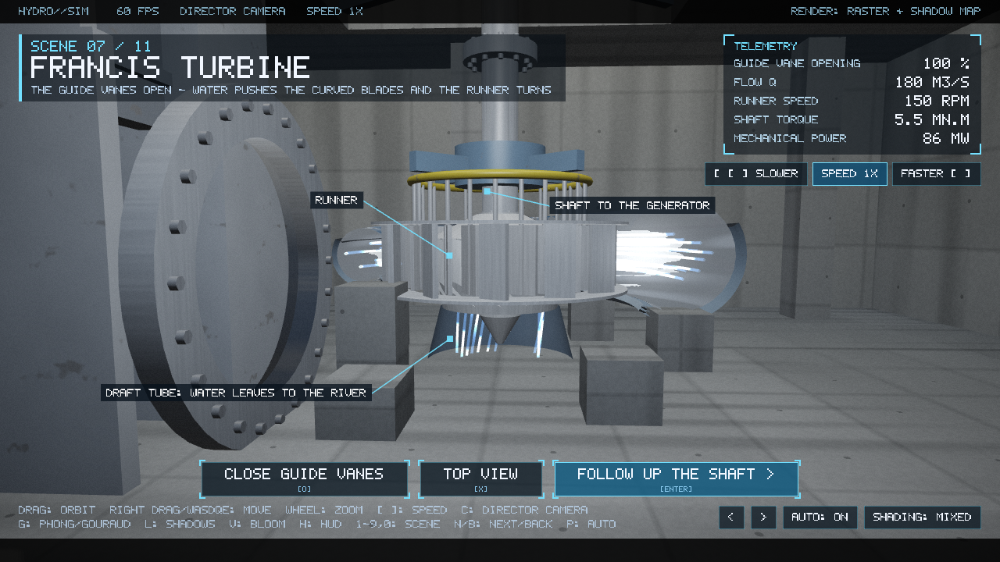
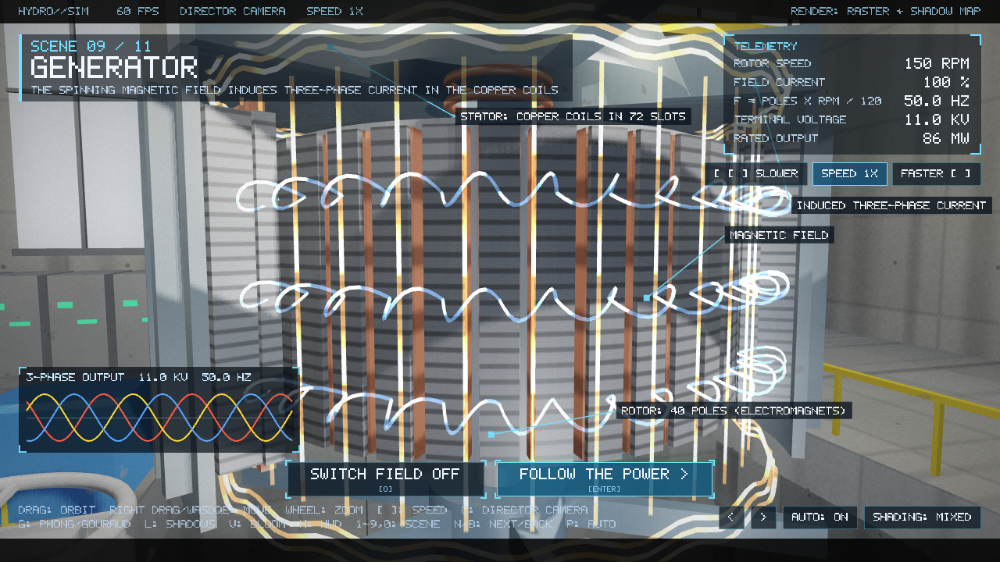
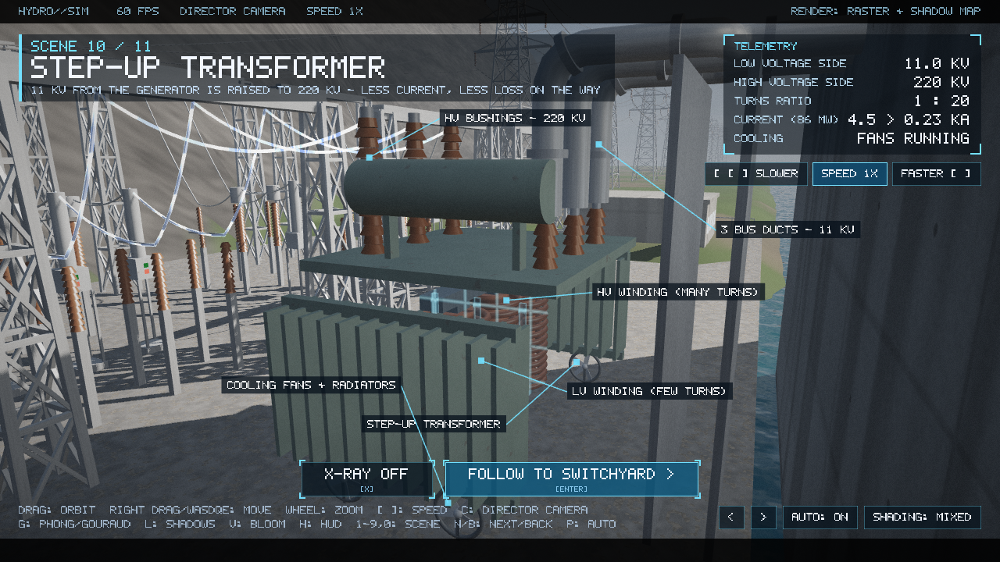
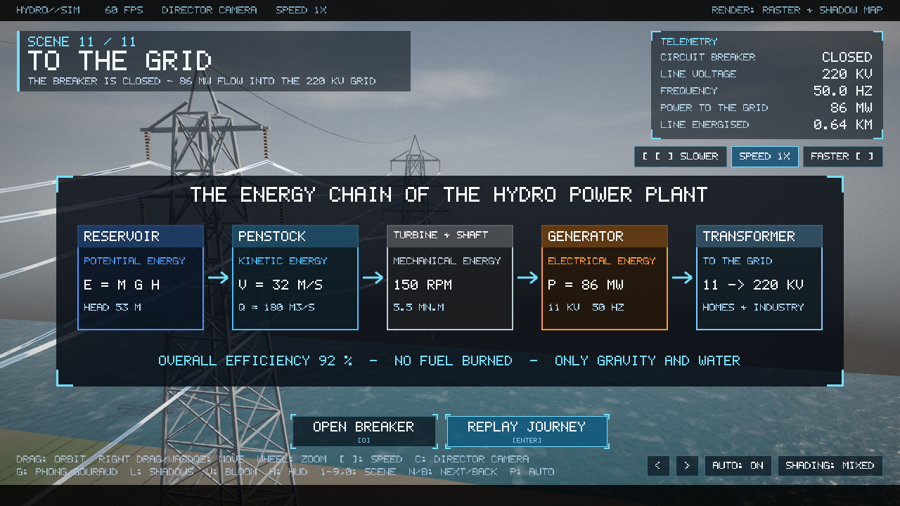

<div align="center">

# HYDRO

### Hydroelectric Power Plant Simulation using OpenGL

*An interactive 3D journey from the reservoir to the power grid.*


<br>



<sub>The finished plant, rendered live by the program.</sub>

</div>

---

## Table of Contents

1. [Overview](#1-overview)
2. [Highlights](#2-highlights)
3. [The Journey: Eleven Connected Scenes](#3-the-journey-eleven-connected-scenes)
4. [Gallery](#4-gallery)
5. [Graphics Techniques](#5-graphics-techniques)
6. [The Plant Model](#6-the-plant-model)
7. [Getting Started](#7-getting-started)
8. [Controls](#8-controls)
9. [Project Structure](#9-project-structure)
10. [Performance and Testing](#10-performance-and-testing)
11. [Documentation](#11-documentation)
12. [Limitations and Future Work](#12-limitations-and-future-work)
13. [Credits](#13-credits)

---

## 1. Overview

**HYDRO** is a real-time, interactive simulation of a hydroelectric power plant,
written from scratch in **C++17** and **OpenGL 3.3 Core**. It follows a drop of
water, and then the energy that the water carries, along its real path:

```
reservoir → trash rack → intake gate → penstock → main inlet valve
          → Francis turbine → shaft → generator
          → bus ducts → step-up transformer → switchyard → power line → grid
```

The whole plant is **one continuous world**. The camera flies from place to place
without cuts, and the same objects are reused in every scene. The viewer is never
a passive spectator: gates must be opened, the turbine started, the generator
excited and the breaker closed before the story can move on.

The project began as a proposal for a small *smart flood sluice gate*. On review,
the course teacher asked for the idea to be grown into a complete hydroelectric
power plant, and the sluice gate became one part of that larger system.

> **Nothing is borrowed.** There are no 3D model files and no image files. Every
> object is built from code, every texture is calculated in a shader, and even the
> on-screen font is drawn by hand. GLFW only opens the window and reads the input;
> GLAD only loads the OpenGL functions. The vector and matrix maths, the camera, the
> shaders, the ray tracer and the screenshot writer were all written for this project.

---

## 2. Highlights

| | |
|---|---|
| **Physically motivated** | One data sheet drives everything: 53 m head, 180 m³/s, 86 MW, 150 rpm, 50 Hz, 11 kV → 220 kV. Every number on screen agrees with every other. |
| **Cause before effect** | A cause-and-effect model makes the order real. The casing fills only after the valve opens; the runner turns only when the guide vanes let water through; voltage needs a spinning *and* excited rotor. |
| **GPU ray tracer** | A Whitted-style ray tracer renders the glass penstock with exact ray–surface intersections, shadow rays, reflection, refraction and volume ray marching. |
| **Switchable shading** | Gouraud and Phong shading side by side, per object, with a single key press. |
| **Full interaction** | On-screen buttons, keyboard, mouse orbit and zoom, a free camera, speed control from 0.25× to 2×, and an AUTO mode that plays the whole story. |
| **Cinematic finish** | Shadow mapping, procedural water, particles, glowing flow lines, bloom, vignette and film grain. |
| **Self-testing** | Deterministic screenshot, benchmark and autotest modes make every figure reproducible. |

---

## 3. The Journey: Eleven Connected Scenes

Each scene has its own buttons at the bottom of the screen. A grey button is not
ready yet; the text under it says what to do first.

| # | Scene | What you see | What you do |
|:-:|---|---|---|
| 1 | **Preview** | The whole plant running: spillway water, cut-away powerhouse, turbine and generator spinning. | Stop / start the water, then follow the water. |
| 2 | **Reservoir and trash rack** | The camera flies over the dam and dives under water to the intake. A cut-away shows trash stopping at the bars while small leaves slip through. | Add more trash, then follow to the intake gate. |
| 3 | **Intake gate** | The dam section lifts away and the gate is revealed. | Open or close the gate. |
| 4 | **Penstock** | Water rushes down the pipe with `v = √(v₀² + 2gh)` and stops at the closed main inlet valve. | X-ray view, replay the flow. |
| 5 | **Ray-traced pipe** | A GPU ray-traced glass penstock with glowing, refracting water. | Raise or lower the head. |
| 6 | **Main inlet valve** | The hand-wheel turns, the valve gate rises and the spiral casing fills. | Open or close the valve. |
| 7 | **Francis turbine** | Water swirls round the casing, 24 guide vanes open and the runner reaches 150 rpm. A section view shows the streamlines through the runner and down the draft tube. | Open the guide vanes, switch section / top view. |
| 8 | **Shaft** | An automatic hologram shot rising up the turning shaft to the generator. | — |
| 9 | **Generator** | Rotor poles spin inside the copper stator. Exciting the rotor shows magnetic field lines and three-phase current; an oscilloscope shows 11 kV at 50 Hz. | Excite the rotor. |
| 10 | **Step-up transformer** | The camera flies out over the roof. Bus ducts carry 11 kV to the transformer, which raises it to 220 kV while its fans spin. | X-ray the transformer. |
| 11 | **To the grid** | Disconnector, circuit breaker, current transformers and arresters. Closing the breaker sends the energy along the line, and a summary of the whole energy chain appears. | Close the breaker, replay the journey. |

---

## 4. Gallery

<table>
  <tr>
    <td width="50%"><br><sub><b>Scene 2.</b> Trash rack: debris stops at the bars.</sub></td>
    <td width="50%"><br><sub><b>Scene 5.</b> The ray-traced glass penstock.</sub></td>
  </tr>
  <tr>
    <td width="50%"><br><sub><b>Scene 7.</b> Francis turbine, section view with streamlines.</sub></td>
    <td width="50%"><br><sub><b>Scene 9.</b> Generator with the rotor excited.</sub></td>
  </tr>
  <tr>
    <td width="50%"><br><sub><b>Scene 10.</b> Step-up transformer in X-ray view.</sub></td>
    <td width="50%"><br><sub><b>Scene 11.</b> Summary of the whole energy chain.</sub></td>
  </tr>
</table>

---

## 5. Graphics Techniques

| Topic | What it does in HYDRO | Where |
|---|---|---|
| **Procedural modelling** | Every object is generated from primitives (boxes, cylinders, spheres, tori, tubes along a path, extruded outlines) and uploaded once as a reusable mesh. | `src/core/Mesh.*`, `src/objects/*` |
| **Transformations** | Translation, rotation, scaling, composite and hierarchical transforms: gates and valve rise, 24 guide vanes turn, the runner and rotor spin, the dam section lifts away. | `src/core/MathLib.h` |
| **Camera system** | Free orbit and fly camera, plus a *director's camera* that glides between key positions. | `src/core/Camera.*`, `src/App.cpp` |
| **Lighting** | Blinn–Phong with a directional sun, point lights in the powerhouse, and daylight, underwater and indoor moods. | `shaders/common.glsl`, `shaders/lit.*` |
| **Gouraud and Phong shading** | Per-vertex and per-fragment shading, switchable live with **G**. | `shaders/gouraud.*`, `shaders/lit.*` |
| **Shadow mapping** | Depth pass with normal offset, bias and polygon offset, and PCF filtering. | `shaders/depth.*`, `src/render/Renderer.*` |
| **Procedural textures** | Concrete, steel, rock, terrain and water computed in the fragment shader. | `shaders/materials.glsl` |
| **Water rendering** | Animated, shaded surface with caustic light, depth tint and free-falling spillway water. | `shaders/water.*`, `src/objects/SpillwayWater.*` |
| **Ray tracing** | Whitted ray tracer on the GPU for the penstock scene: exact cylinder, box and plane intersections, shadow rays, reflection, refraction and ray marching. | `shaders/raytrace.frag`, `src/scenes/Scene5_*` |
| **Animation and physics** | Free fall and Torricelli flow, machines with inertia, floating debris, particles and glowing flow lines. | `src/objects/World.cpp`, `src/render/ParticleSystem.*`, `src/objects/FlowLines.*` |
| **Post-processing** | Bloom (quarter resolution), vignette, film grain, tone mapping and scene dissolves. | `shaders/post_*.frag`, `src/render/PostFX.*`, `src/render/FrameCapture.*` |
| **User interface** | A pixel font and a tiny immediate-mode UI for buttons, panels, labels and the oscilloscope. | `src/ui/*`, `shaders/ui.*` |
| **Interaction** | Keyboard, mouse and on-screen buttons, each scene's buttons locked until its cause is satisfied. | `src/App.cpp`, `src/scenes/*` |

---

## 6. The Plant Model

All numbers come from a single file, `src/objects/PlantData.h`, so the on-screen
read-outs never contradict each other.

| Quantity | Value | Derived from |
|---|---:|---|
| Gross head | **53 m** | reservoir level 56 m − tailwater level 3 m |
| Flow through the unit | **180 m³/s** | full gate opening |
| Efficiency | **92 %** | assumed overall turbine efficiency |
| Output power | **86 MW** | `P = ρ · g · Q · H · η` |
| Speed | **150 rpm** | fixed by the grid frequency |
| Rotor poles | **40** | `f = poles × rpm / 120` |
| Frequency | **50 Hz** | 40 × 150 / 120 |
| Generator voltage | **11 kV** | machine rating |
| Grid voltage | **220 kV** | after the step-up transformer |

Water takes this path, and each step only happens once the one before it is done:

| Effect | Needs |
|---|---|
| Conduit fills | Intake gate open |
| Penstock fills | Conduit full |
| Spiral casing fills | Valve open **and** penstock full |
| Runner turns | Guide vanes open **and** casing full |
| Generator voltage | Runner at speed **and** rotor excited |
| Power line is live | Breaker closed **and** generator voltage up |

The 3D rotor turns more slowly than the real 150 rpm, so the eye can follow it.

---

## 7. Getting Started

### Requirements

- Windows 10 or 11
- A graphics card with **OpenGL 3.3** support
- **MSYS2 MinGW-w64** installed at `C:\msys64\mingw64`, with the GLFW package:

  ```bash
  pacman -S mingw-w64-x86_64-gcc mingw-w64-x86_64-glfw
  ```

### Clone

```bash
git clone https://github.com/tahmidalbi/Hydro-electric-Powerplant-Simulation-with-OpenGL.git
cd Hydro-electric-Powerplant-Simulation-with-OpenGL/HYDRO
```

### Build and run

```bat
run.bat
```

`run.bat` builds the program the first time and then starts it. To compile
separately:

```bat
build.bat        :: compiles to build\hydro.exe and copies the shaders
run.bat          :: starts the program
```

CMake is also supported:

```bat
cmake -G "MinGW Makefiles" -B build
cmake --build build
```

### Command-line options

| Option | Effect |
|---|---|
| `--size 1920 1080` | Window size |
| `--nopost` | Start without bloom, vignette and grain (faster on weak GPUs) |
| `--noshadows` | Start with shadows off |
| `--shading phong\|gouraud` | Start in the given shading mode |
| `--bench` | Print the real frame time of every scene |
| `--shot 7 19 pic.bmp` | Start scene 7, run 19 s on AUTO, save a picture |
| `--autotest 60 pic.bmp` | Run the real frame loop on AUTO for 60 s, then save a picture |

---

## 8. Controls

| Key / mouse | Action |
|---|---|
| **Left mouse drag** | Orbit the camera |
| **Right mouse drag**, `W` `A` `S` `D` `Q` `E` | Move the camera |
| **Mouse wheel** | Zoom |
| `C` | Return to the director's camera |
| `[` `]` (also `-` `=`) or the **SPEED** buttons | Slower / faster: 0.25× · 0.5× · 1× · 2× |
| `G` | Shading: mixed → all Phong → all Gouraud |
| `L` | Shadows on / off |
| `V` | Bloom, vignette and film grain on / off |
| `H` | Hide / show the HUD |
| `P` | **AUTO**: the whole story plays by itself (about 3 minutes) |
| `1` … `9`, `0` | Jump to scene 1–9, 10 (use `N` for 11) |
| `N` / `→`, `B` / `←` | Next / previous scene |
| `R` | Restart the current scene |
| `F12` | Save a screenshot into `captures\` |
| `Esc` | Quit |

Scene-specific buttons (open the gate, excite the rotor, close the breaker, …) are
shown at the bottom of the screen together with their shortcut keys.

---

## 9. Project Structure

```
HYDRO/
├── build.bat · run.bat · CMakeLists.txt
├── shaders/                 21 GLSL files: lighting, water, sky, particles,
│                            ray tracer, flow lines, post-processing, HUD
├── src/
│   ├── main.cpp             command line
│   ├── App.cpp / .h         window, input, transitions, speed control, HUD
│   ├── core/                MathLib, Mesh + MeshBuilder, Shader, Camera, Screenshot
│   ├── render/              Renderer, ParticleSystem, FrameCapture, PostFX
│   ├── objects/             one file per object + World + PlantData
│   │                        (Dam, TrashRack, IntakeGate, MainInletValve, TurbineUnit,
│   │                         Generator, Transformer, Switchyard, TransmissionLine, …)
│   ├── scenes/              Scene1_Preview … Scene11_Grid
│   └── ui/                  pixel Font, Ui
├── docs/                    technical notes
├── captures/                pictures rendered by the program
└── report/                  full project report (LaTeX source and PDF)
```

The code base is roughly **8,000 lines of C++** and **1,300 lines of GLSL**. Every
object has its own file, every scene has its own file, and all scenes look at the
same `World` object, so nothing is duplicated.

---

## 10. Performance and Testing

Every figure in the report was produced by the program itself, from scripted,
deterministic runs, so any picture can be reproduced exactly.

| Scene | ms / frame | fps | | Scene | ms / frame | fps |
|---|---:|---:|---|---|---:|---:|
| 1 Preview | 26.6 | 37.5 | | 7 Francis turbine | 22.8 | 43.8 |
| 2 Reservoir | 18.7 | 53.6 | | 8 Shaft | 22.7 | 44.0 |
| 3 Intake gate | 20.2 | 49.4 | | 9 Generator | 27.0 | 37.0 |
| 4 Penstock | 20.6 | 48.6 | | 10 Transformer | 18.8 | 53.1 |
| 5 Ray-traced pipe | 29.3 | 34.1 | | 11 Switchyard | 16.6 | 60.4 |
| 6 Main inlet valve | 23.7 | 42.2 | | | | |

<sub>Measured at 1600 × 900 on a laptop with an NVIDIA GeForce GTX 1650.</sub>

Performance comes from drawing only what can be seen: distance and room-based
culling of the detailed machines, meshes built once and reused (one guide vane drawn
24 times), a quarter-resolution bloom, and particles stored in a fixed-capacity
array with constant-time removal.

---

## 11. Documentation

| Document | Contents |
|---|---|
| [`HYDRO/report/main.pdf`](HYDRO/report/main.pdf) | Full project report: design, theory, objects, walkthrough, results |
| [`HYDRO/report/main.tex`](HYDRO/report/main.tex) | LaTeX source of the report |
| [`HYDRO/docs/HOW_IT_WORKS.md`](HYDRO/docs/HOW_IT_WORKS.md) | Each graphics topic explained, with file names and how to show it live |

---

## 12. Limitations and Future Work

**Limitations**

- Interiors are cut-away teaching diagrams, not fully closed engineering models.
- Physics is simplified for teaching: water fronts follow free-fall and Torricelli
  formulas rather than a fluid simulation, and water is shown slower than real speed.
- The plant has a single turbine–generator unit.
- Ray tracing is used for the penstock scene only; the rest of the world is rasterised.
- Only the sun casts shadows; the powerhouse lamps do not.
- There is no sound.

**Future work**

- Several turbine units with a control room that shares load between them.
- A simple fluid simulation for the spillway and the reservoir surface.
- Ray-traced reflections and soft shadows for the whole world.
- Shadows from the powerhouse lamps using cube shadow maps.
- Sound: rushing water, the hum of the generator, the click of the breaker.
- A day–night cycle with lights coming on along the transmission line.

---

## 13. Credits

**Author:** Md. Tahmid Islam, Roll 2107107

**Course project:** Computer Graphics, Department of Computer Science and
Engineering, Khulna University of Engineering & Technology (KUET), Khulna 9203,
Bangladesh.

**Supervision:** Md Tajmilur Rahman, Lecturer, and Md. Mubtashim Abrar Nihal, Lecturer.

**Built with:** [GLFW](https://www.glfw.org/) (window and input) and
[GLAD](https://glad.dav1d.de/) (OpenGL function loader). Everything else is
original project code.

<div align="center">
<sub>HYDRO — from a drop of water to the power grid.</sub>
</div>
